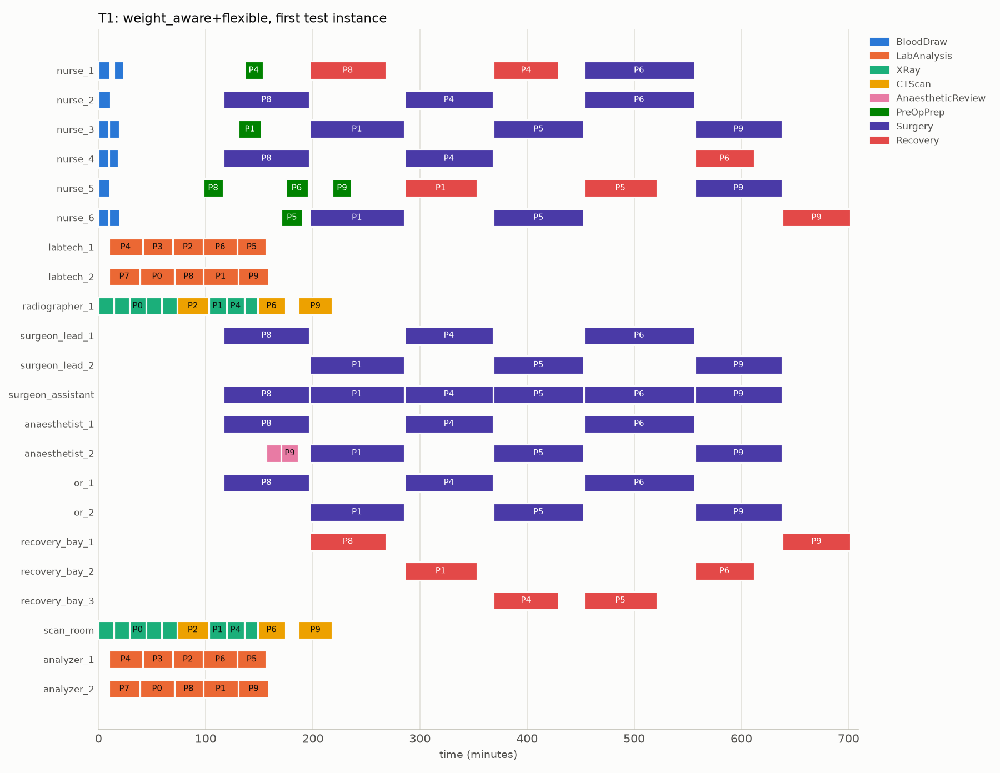
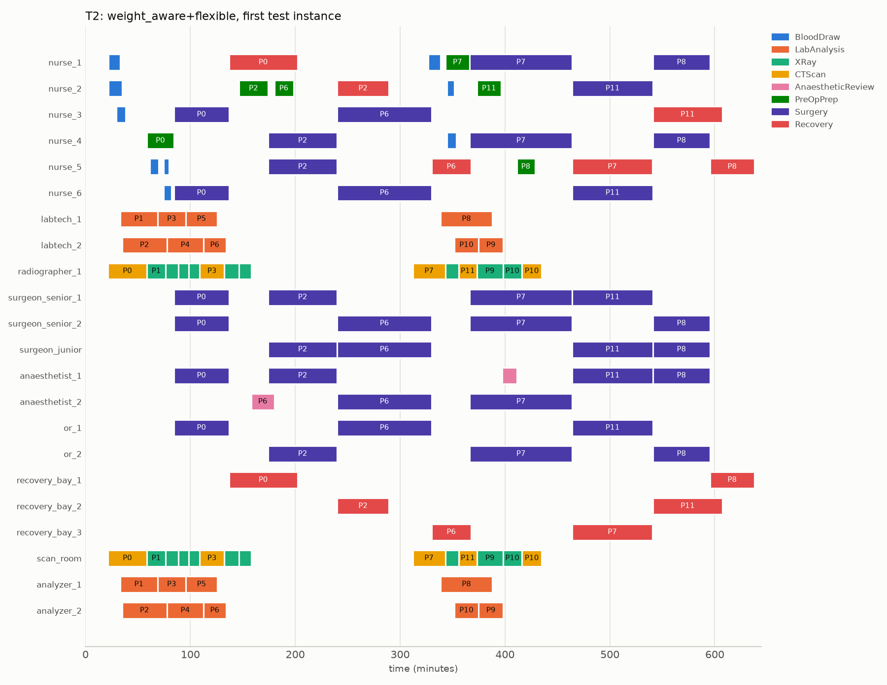
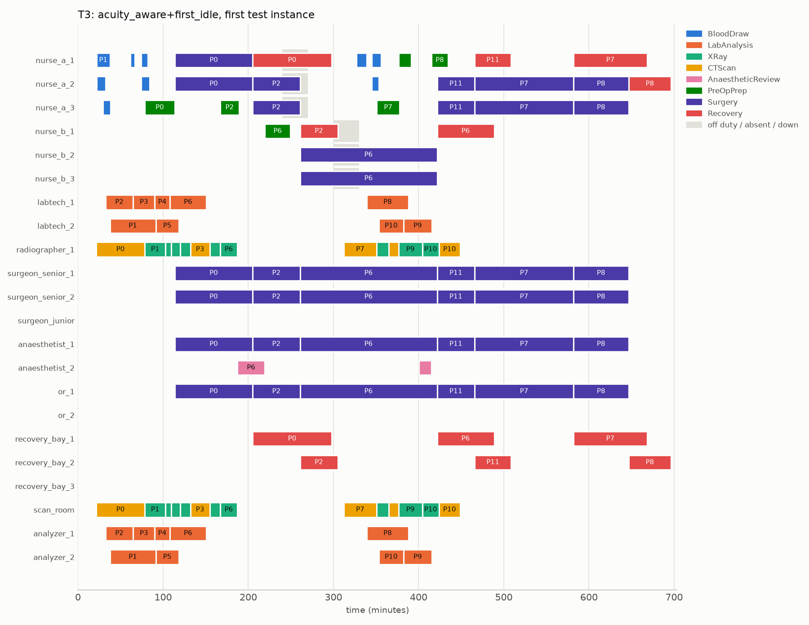
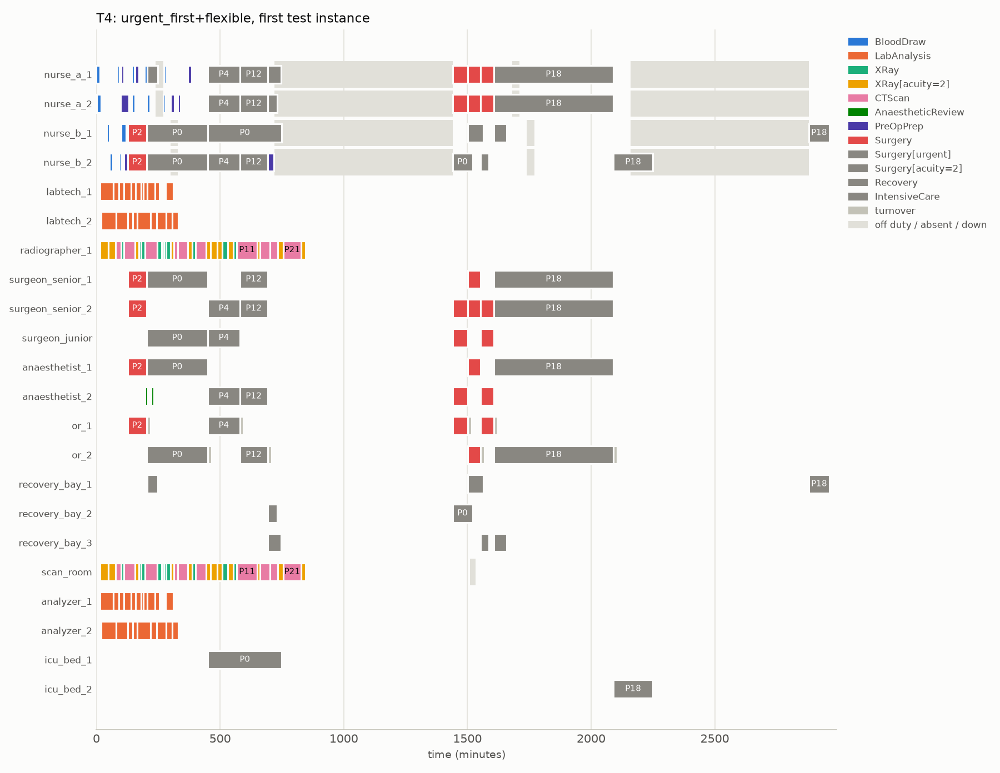
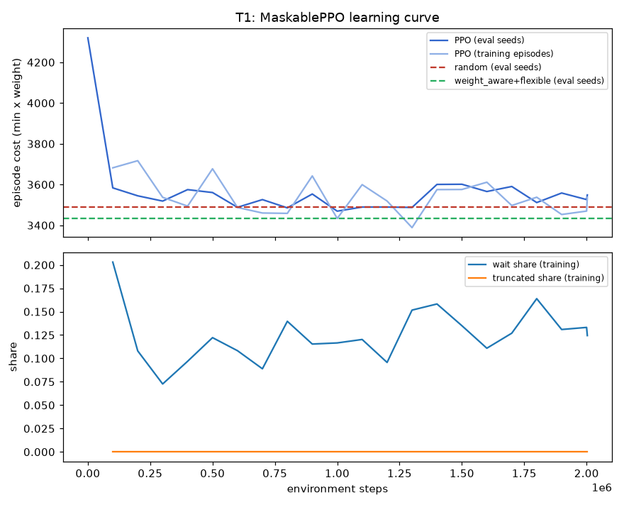
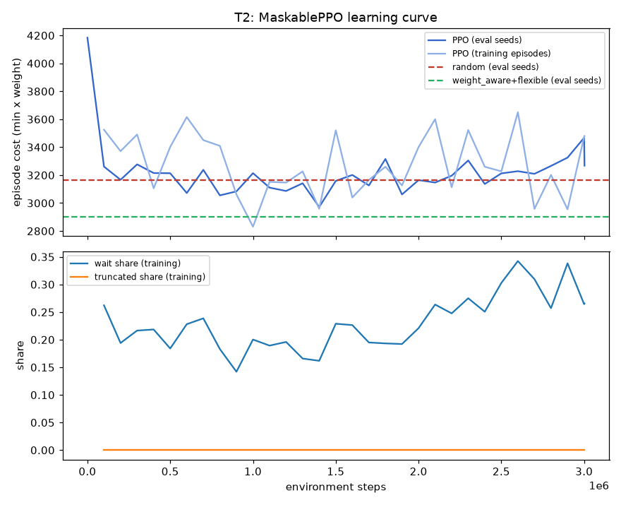
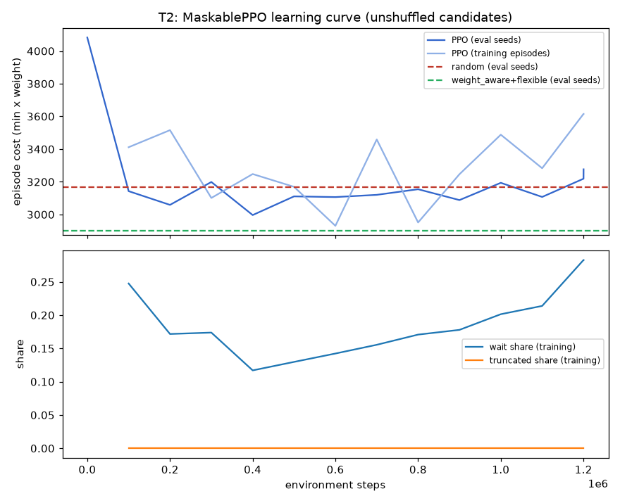

# Baseline results, v0.1

Reference numbers for `hospital_sim` 0.1.0 on the frozen benchmark tiers (`benchmarks/tiers/`, see its README). Regenerate with `benchmarks/run_v01_baselines.py`, `benchmarks/ppo_smoke.py` and `benchmarks/run_v01_throughput.py`; this page is rendered by `benchmarks/v01_report.py` from `benchmarks/results/v0.1/`.

**These are results on illustrative scenarios, not on a model of any real hospital.** They compare methods under controlled conditions only.

## Heuristic baselines

Every dispatching rule (including `random`) with every allocation rule, on the 200 frozen **test** seeds of each tier, through `hospital_sim.eval.evaluate` (all policies on identical instances). Cells are mean ± half-width of the 95% t confidence interval over episodes. Times are in minutes.

- **episode cost** is what the default reward sums to, before scaling: total weighted flow time plus `leave_penalty` × weight of patients who left unseen (minutes × weight). The best heuristic is chosen on it.
- **weighted mean flow** is total weighted flow time over the arrived weight. Leavers count with the time they waited, so read it together with **leavers**.
- **overtime** is resource-minutes worked past the end of a shift (tiers with rosters only).
- The truncation rate is 0% for every heuristic (they always run to completion), so it is not repeated per row. The column exists for RL agents in §PPO.

### Summary

| Tier | Best heuristic (episode cost) | its episode cost | `random+flexible` | best − random (paired) | best by weighted mean flow |
|---|---|---|---|---|---|
| T1 | **weight_aware+flexible** | 3522 ± 122 | 3653 ± 127 | -130 ± 26 (-3.6%) | weight_aware+flexible |
| T2 | **weight_aware+flexible** | 2975 ± 284 | 3236 ± 329 | -262 ± 71 (-8.1%) | weight_aware+flexible |
| T3 | **acuity_aware+first_idle** | 3216 ± 364 | 3771 ± 527 | -554 ± 209 (-14.7%) | acuity_aware+first_idle |
| T4 | **urgent_first+flexible** | 10563 ± 901 | 11946 ± 1070 | -1383 ± 426 (-11.6%) | urgent_first+first_idle |

### T1

Leave penalty 540 min × weight. Best heuristic in bold; paired gap of the best heuristic to `random+flexible`: episode cost -130 ± 26, weighted mean flow -13.0 ± 2.6. Best random allocation: `random+flexible`. Identical on every episode to the best: `weight_aware+fastest`, `weight_aware+least_used`, `weight_aware+first_idle`, `acuity_aware+flexible`, `acuity_aware+fastest`, `acuity_aware+least_used`, `acuity_aware+first_idle`.

| Policy | episode cost | weighted mean flow | mean flow | makespan | overtime | leavers | truncated |
|---|---|---|---|---|---|---|---|
| **weight_aware+flexible** | 3522 ± 122 | 352.2 ± 12.2 | 352.2 ± 12.2 | 744 ± 15 | 0.0 ± 0.0 | 0.00 ± 0.00 | 0% |
| weight_aware+fastest | 3522 ± 122 | 352.2 ± 12.2 | 352.2 ± 12.2 | 744 ± 15 | 0.0 ± 0.0 | 0.00 ± 0.00 | 0% |
| weight_aware+least_used | 3522 ± 122 | 352.2 ± 12.2 | 352.2 ± 12.2 | 744 ± 15 | 0.0 ± 0.0 | 0.00 ± 0.00 | 0% |
| weight_aware+first_idle | 3522 ± 122 | 352.2 ± 12.2 | 352.2 ± 12.2 | 744 ± 15 | 0.0 ± 0.0 | 0.00 ± 0.00 | 0% |
| acuity_aware+flexible | 3522 ± 122 | 352.2 ± 12.2 | 352.2 ± 12.2 | 744 ± 15 | 0.0 ± 0.0 | 0.00 ± 0.00 | 0% |
| acuity_aware+fastest | 3522 ± 122 | 352.2 ± 12.2 | 352.2 ± 12.2 | 744 ± 15 | 0.0 ± 0.0 | 0.00 ± 0.00 | 0% |
| acuity_aware+least_used | 3522 ± 122 | 352.2 ± 12.2 | 352.2 ± 12.2 | 744 ± 15 | 0.0 ± 0.0 | 0.00 ± 0.00 | 0% |
| acuity_aware+first_idle | 3522 ± 122 | 352.2 ± 12.2 | 352.2 ± 12.2 | 744 ± 15 | 0.0 ± 0.0 | 0.00 ± 0.00 | 0% |
| spt+flexible | 3561 ± 124 | 356.1 ± 12.4 | 356.1 ± 12.4 | 710 ± 18 | 0.0 ± 0.0 | 0.00 ± 0.00 | 0% |
| spt+fastest | 3561 ± 124 | 356.1 ± 12.4 | 356.1 ± 12.4 | 710 ± 18 | 0.0 ± 0.0 | 0.00 ± 0.00 | 0% |
| spt+least_used | 3561 ± 124 | 356.1 ± 12.4 | 356.1 ± 12.4 | 710 ± 18 | 0.0 ± 0.0 | 0.00 ± 0.00 | 0% |
| spt+first_idle | 3561 ± 124 | 356.1 ± 12.4 | 356.1 ± 12.4 | 710 ± 18 | 0.0 ± 0.0 | 0.00 ± 0.00 | 0% |
| most_constrained_first+flexible | 3606 ± 126 | 360.6 ± 12.6 | 360.6 ± 12.6 | 710 ± 19 | 0.0 ± 0.0 | 0.00 ± 0.00 | 0% |
| most_constrained_first+fastest | 3606 ± 126 | 360.6 ± 12.6 | 360.6 ± 12.6 | 710 ± 19 | 0.0 ± 0.0 | 0.00 ± 0.00 | 0% |
| most_constrained_first+least_used | 3606 ± 126 | 360.6 ± 12.6 | 360.6 ± 12.6 | 710 ± 19 | 0.0 ± 0.0 | 0.00 ± 0.00 | 0% |
| most_constrained_first+first_idle | 3606 ± 126 | 360.6 ± 12.6 | 360.6 ± 12.6 | 710 ± 19 | 0.0 ± 0.0 | 0.00 ± 0.00 | 0% |
| fifo+flexible | 3608 ± 127 | 360.8 ± 12.7 | 360.8 ± 12.7 | 710 ± 19 | 0.0 ± 0.0 | 0.00 ± 0.00 | 0% |
| fifo+fastest | 3608 ± 127 | 360.8 ± 12.7 | 360.8 ± 12.7 | 710 ± 19 | 0.0 ± 0.0 | 0.00 ± 0.00 | 0% |
| fifo+least_used | 3608 ± 127 | 360.8 ± 12.7 | 360.8 ± 12.7 | 710 ± 19 | 0.0 ± 0.0 | 0.00 ± 0.00 | 0% |
| fifo+first_idle | 3608 ± 127 | 360.8 ± 12.7 | 360.8 ± 12.7 | 710 ± 19 | 0.0 ± 0.0 | 0.00 ± 0.00 | 0% |
| urgent_first+flexible | 3608 ± 127 | 360.8 ± 12.7 | 360.8 ± 12.7 | 710 ± 19 | 0.0 ± 0.0 | 0.00 ± 0.00 | 0% |
| urgent_first+fastest | 3608 ± 127 | 360.8 ± 12.7 | 360.8 ± 12.7 | 710 ± 19 | 0.0 ± 0.0 | 0.00 ± 0.00 | 0% |
| urgent_first+least_used | 3608 ± 127 | 360.8 ± 12.7 | 360.8 ± 12.7 | 710 ± 19 | 0.0 ± 0.0 | 0.00 ± 0.00 | 0% |
| urgent_first+first_idle | 3608 ± 127 | 360.8 ± 12.7 | 360.8 ± 12.7 | 710 ± 19 | 0.0 ± 0.0 | 0.00 ± 0.00 | 0% |
| random+flexible | 3653 ± 127 | 365.3 ± 12.7 | 365.3 ± 12.7 | 720 ± 18 | 0.0 ± 0.0 | 0.00 ± 0.00 | 0% |
| random+fastest | 3653 ± 127 | 365.3 ± 12.7 | 365.3 ± 12.7 | 720 ± 18 | 0.0 ± 0.0 | 0.00 ± 0.00 | 0% |
| random+least_used | 3653 ± 127 | 365.3 ± 12.7 | 365.3 ± 12.7 | 720 ± 18 | 0.0 ± 0.0 | 0.00 ± 0.00 | 0% |
| random+first_idle | 3653 ± 127 | 365.3 ± 12.7 | 365.3 ± 12.7 | 720 ± 18 | 0.0 ± 0.0 | 0.00 ± 0.00 | 0% |
| longest_remaining_work+flexible | 3884 ± 130 | 388.4 ± 13.0 | 388.4 ± 13.0 | 727 ± 20 | 0.0 ± 0.0 | 0.00 ± 0.00 | 0% |
| longest_remaining_work+fastest | 3884 ± 130 | 388.4 ± 13.0 | 388.4 ± 13.0 | 727 ± 20 | 0.0 ± 0.0 | 0.00 ± 0.00 | 0% |
| longest_remaining_work+least_used | 3884 ± 130 | 388.4 ± 13.0 | 388.4 ± 13.0 | 727 ± 20 | 0.0 ± 0.0 | 0.00 ± 0.00 | 0% |
| longest_remaining_work+first_idle | 3884 ± 130 | 388.4 ± 13.0 | 388.4 ± 13.0 | 727 ± 20 | 0.0 ± 0.0 | 0.00 ± 0.00 | 0% |

*T1: Gantt chart of `weight_aware+flexible` on the first test instance (one row per resource; colour = operation type; label = patient).*

### T2

Leave penalty 570 min × weight. Best heuristic in bold; paired gap of the best heuristic to `random+flexible`: episode cost -262 ± 71, weighted mean flow -14.2 ± 3.2. Best random allocation: `random+flexible`. Identical on every episode to the best: `weight_aware+fastest`, `weight_aware+first_idle`, `acuity_aware+flexible`, `acuity_aware+fastest`, `acuity_aware+first_idle`.

| Policy | episode cost | weighted mean flow | mean flow | makespan | overtime | leavers | truncated |
|---|---|---|---|---|---|---|---|
| **weight_aware+flexible** | 2975 ± 284 | 192.0 ± 8.6 | 185.4 ± 9.4 | 616 ± 25 | 0.0 ± 0.0 | 0.00 ± 0.00 | 0% |
| weight_aware+fastest | 2975 ± 284 | 192.0 ± 8.6 | 185.4 ± 9.4 | 616 ± 25 | 0.0 ± 0.0 | 0.00 ± 0.00 | 0% |
| weight_aware+first_idle | 2975 ± 284 | 192.0 ± 8.6 | 185.4 ± 9.4 | 616 ± 25 | 0.0 ± 0.0 | 0.00 ± 0.00 | 0% |
| acuity_aware+flexible | 2975 ± 284 | 192.0 ± 8.6 | 185.4 ± 9.4 | 616 ± 25 | 0.0 ± 0.0 | 0.00 ± 0.00 | 0% |
| acuity_aware+fastest | 2975 ± 284 | 192.0 ± 8.6 | 185.4 ± 9.4 | 616 ± 25 | 0.0 ± 0.0 | 0.00 ± 0.00 | 0% |
| acuity_aware+first_idle | 2975 ± 284 | 192.0 ± 8.6 | 185.4 ± 9.4 | 616 ± 25 | 0.0 ± 0.0 | 0.00 ± 0.00 | 0% |
| urgent_first+flexible | 3006 ± 288 | 193.8 ± 8.9 | 187.4 ± 9.7 | 600 ± 24 | 0.0 ± 0.0 | 0.00 ± 0.00 | 0% |
| urgent_first+fastest | 3006 ± 288 | 193.8 ± 8.9 | 187.4 ± 9.7 | 600 ± 24 | 0.0 ± 0.0 | 0.00 ± 0.00 | 0% |
| urgent_first+first_idle | 3006 ± 288 | 193.8 ± 8.9 | 187.4 ± 9.7 | 600 ± 24 | 0.0 ± 0.0 | 0.00 ± 0.00 | 0% |
| random+flexible | 3236 ± 329 | 206.3 ± 10.2 | 192.3 ± 9.9 | 608 ± 24 | 0.0 ± 0.0 | 0.00 ± 0.00 | 0% |
| random+fastest | 3236 ± 329 | 206.3 ± 10.2 | 192.3 ± 9.9 | 608 ± 24 | 0.0 ± 0.0 | 0.00 ± 0.00 | 0% |
| random+first_idle | 3236 ± 329 | 206.3 ± 10.2 | 192.3 ± 9.9 | 608 ± 24 | 0.0 ± 0.0 | 0.00 ± 0.00 | 0% |
| weight_aware+least_used | 3253 ± 318 | 208.9 ± 10.0 | 201.9 ± 10.9 | 667 ± 29 | 0.0 ± 0.0 | 0.00 ± 0.00 | 0% |
| acuity_aware+least_used | 3253 ± 318 | 208.9 ± 10.0 | 201.9 ± 10.9 | 667 ± 29 | 0.0 ± 0.0 | 0.00 ± 0.00 | 0% |
| urgent_first+least_used | 3268 ± 317 | 210.1 ± 10.2 | 204.1 ± 11.2 | 651 ± 28 | 0.0 ± 0.0 | 0.00 ± 0.00 | 0% |
| fifo+flexible | 3305 ± 366 | 207.2 ± 11.2 | 187.5 ± 9.7 | 601 ± 24 | 0.0 ± 0.0 | 0.00 ± 0.00 | 0% |
| fifo+fastest | 3305 ± 366 | 207.2 ± 11.2 | 187.5 ± 9.7 | 601 ± 24 | 0.0 ± 0.0 | 0.00 ± 0.00 | 0% |
| fifo+first_idle | 3305 ± 366 | 207.2 ± 11.2 | 187.5 ± 9.7 | 601 ± 24 | 0.0 ± 0.0 | 0.00 ± 0.00 | 0% |
| most_constrained_first+flexible | 3332 ± 363 | 210.6 ± 11.0 | 192.2 ± 9.4 | 608 ± 24 | 0.0 ± 0.0 | 0.00 ± 0.00 | 0% |
| most_constrained_first+fastest | 3332 ± 363 | 210.6 ± 11.0 | 192.2 ± 9.4 | 608 ± 24 | 0.0 ± 0.0 | 0.00 ± 0.00 | 0% |
| most_constrained_first+first_idle | 3332 ± 363 | 210.6 ± 11.0 | 192.2 ± 9.4 | 608 ± 24 | 0.0 ± 0.0 | 0.00 ± 0.00 | 0% |
| longest_remaining_work+flexible | 3349 ± 368 | 210.1 ± 11.3 | 194.6 ± 10.4 | 599 ± 24 | 0.0 ± 0.0 | 0.00 ± 0.00 | 0% |
| longest_remaining_work+fastest | 3349 ± 368 | 210.1 ± 11.3 | 194.6 ± 10.4 | 599 ± 24 | 0.0 ± 0.0 | 0.00 ± 0.00 | 0% |
| longest_remaining_work+first_idle | 3349 ± 368 | 210.1 ± 11.3 | 194.6 ± 10.4 | 599 ± 24 | 0.0 ± 0.0 | 0.00 ± 0.00 | 0% |
| spt+flexible | 3361 ± 381 | 209.6 ± 11.7 | 187.1 ± 9.6 | 603 ± 24 | 0.0 ± 0.0 | 0.00 ± 0.00 | 0% |
| spt+fastest | 3361 ± 381 | 209.6 ± 11.7 | 187.1 ± 9.6 | 603 ± 24 | 0.0 ± 0.0 | 0.00 ± 0.00 | 0% |
| spt+first_idle | 3361 ± 381 | 209.6 ± 11.7 | 187.1 ± 9.6 | 603 ± 24 | 0.0 ± 0.0 | 0.00 ± 0.00 | 0% |
| random+least_used | 3612 ± 386 | 227.8 ± 12.2 | 209.7 ± 11.3 | 659 ± 28 | 0.0 ± 0.0 | 0.00 ± 0.00 | 0% |
| fifo+least_used | 3649 ± 411 | 227.5 ± 13.1 | 204.0 ± 11.1 | 651 ± 28 | 0.0 ± 0.0 | 0.00 ± 0.00 | 0% |
| most_constrained_first+least_used | 3664 ± 409 | 230.1 ± 12.7 | 208.1 ± 10.7 | 656 ± 27 | 0.0 ± 0.0 | 0.00 ± 0.00 | 0% |
| longest_remaining_work+least_used | 3693 ± 415 | 230.3 ± 13.1 | 211.5 ± 11.9 | 651 ± 28 | 0.0 ± 0.0 | 0.00 ± 0.00 | 0% |
| spt+least_used | 3717 ± 431 | 230.4 ± 13.7 | 203.7 ± 11.1 | 654 ± 28 | 0.0 ± 0.0 | 0.00 ± 0.00 | 0% |

*T2: Gantt chart of `weight_aware+flexible` on the first test instance (one row per resource; colour = operation type; label = patient).*

### T3

Leave penalty 570 min × weight. Best heuristic in bold; paired gap of the best heuristic to `random+flexible`: episode cost -554 ± 209, weighted mean flow -26.4 ± 8.4. Best random allocation: `random+flexible`.

| Policy | episode cost | weighted mean flow | mean flow | makespan | overtime | leavers | truncated |
|---|---|---|---|---|---|---|---|
| **acuity_aware+first_idle** | 3216 ± 364 | 202.0 ± 11.6 | 199.7 ± 13.6 | 742 ± 58 | 80.3 ± 9.0 | 0.00 ± 0.00 | 0% |
| acuity_aware+flexible | 3227 ± 368 | 202.3 ± 11.7 | 199.8 ± 13.6 | 742 ± 58 | 74.7 ± 8.8 | 0.00 ± 0.00 | 0% |
| acuity_aware+fastest | 3227 ± 368 | 202.3 ± 11.7 | 199.8 ± 13.6 | 742 ± 58 | 74.7 ± 8.8 | 0.00 ± 0.00 | 0% |
| weight_aware+first_idle | 3280 ± 392 | 204.6 ± 12.4 | 203.5 ± 14.8 | 745 ± 60 | 77.6 ± 8.7 | 0.00 ± 0.00 | 0% |
| weight_aware+flexible | 3293 ± 397 | 205.0 ± 12.5 | 203.5 ± 14.8 | 745 ± 60 | 72.7 ± 8.7 | 0.00 ± 0.00 | 0% |
| weight_aware+fastest | 3293 ± 397 | 205.0 ± 12.5 | 203.5 ± 14.8 | 745 ± 60 | 72.7 ± 8.7 | 0.00 ± 0.00 | 0% |
| urgent_first+first_idle | 3299 ± 392 | 205.8 ± 12.4 | 204.1 ± 14.6 | 717 ± 58 | 79.4 ± 8.7 | 0.00 ± 0.00 | 0% |
| urgent_first+flexible | 3311 ± 396 | 206.2 ± 12.5 | 204.1 ± 14.6 | 717 ± 58 | 73.1 ± 8.4 | 0.00 ± 0.00 | 0% |
| urgent_first+fastest | 3311 ± 396 | 206.2 ± 12.5 | 204.1 ± 14.6 | 717 ± 58 | 73.1 ± 8.4 | 0.00 ± 0.00 | 0% |
| acuity_aware+least_used | 3597 ± 420 | 224.2 ± 14.0 | 224.8 ± 16.7 | 848 ± 69 | 100.0 ± 12.6 | 0.00 ± 0.00 | 0% |
| weight_aware+least_used | 3691 ± 447 | 228.2 ± 14.8 | 228.5 ± 17.3 | 854 ± 68 | 98.1 ± 12.3 | 0.00 ± 0.00 | 0% |
| urgent_first+least_used | 3749 ± 463 | 231.4 ± 15.7 | 230.8 ± 17.7 | 828 ± 67 | 95.4 ± 11.8 | 0.00 ± 0.00 | 0% |
| random+flexible | 3771 ± 527 | 228.4 ± 17.4 | 209.6 ± 15.1 | 738 ± 59 | 78.9 ± 9.7 | 0.00 ± 0.00 | 0% |
| random+fastest | 3771 ± 527 | 228.4 ± 17.4 | 209.6 ± 15.1 | 738 ± 59 | 78.9 ± 9.7 | 0.00 ± 0.00 | 0% |
| longest_remaining_work+first_idle | 3781 ± 541 | 227.0 ± 17.0 | 209.9 ± 15.3 | 714 ± 57 | 83.7 ± 9.8 | 0.00 ± 0.00 | 0% |
| longest_remaining_work+flexible | 3781 ± 541 | 227.0 ± 17.0 | 210.0 ± 15.3 | 714 ± 57 | 76.8 ± 9.7 | 0.00 ± 0.00 | 0% |
| longest_remaining_work+fastest | 3781 ± 541 | 227.0 ± 17.0 | 210.0 ± 15.3 | 714 ± 57 | 76.8 ± 9.7 | 0.00 ± 0.00 | 0% |
| fifo+first_idle | 3827 ± 559 | 228.2 ± 18.0 | 202.7 ± 13.8 | 720 ± 56 | 82.3 ± 9.8 | 0.00 ± 0.00 | 0% |
| fifo+flexible | 3828 ± 559 | 228.2 ± 18.0 | 202.8 ± 13.8 | 720 ± 56 | 75.8 ± 9.6 | 0.00 ± 0.00 | 0% |
| fifo+fastest | 3828 ± 559 | 228.2 ± 18.0 | 202.8 ± 13.8 | 720 ± 56 | 75.8 ± 9.6 | 0.00 ± 0.00 | 0% |
| random+first_idle | 3831 ± 609 | 230.3 ± 19.9 | 209.4 ± 15.2 | 735 ± 59 | 83.1 ± 9.3 | 0.00 ± 0.00 | 0% |
| most_constrained_first+first_idle | 3900 ± 597 | 233.1 ± 18.9 | 208.2 ± 14.2 | 732 ± 59 | 84.7 ± 9.6 | 0.00 ± 0.00 | 0% |
| most_constrained_first+flexible | 3901 ± 597 | 233.2 ± 18.9 | 208.1 ± 14.2 | 733 ± 59 | 78.2 ± 9.6 | 0.00 ± 0.00 | 0% |
| most_constrained_first+fastest | 3901 ± 597 | 233.2 ± 18.9 | 208.1 ± 14.2 | 733 ± 59 | 78.2 ± 9.6 | 0.00 ± 0.00 | 0% |
| spt+first_idle | 3977 ± 613 | 234.4 ± 19.7 | 203.6 ± 14.0 | 732 ± 59 | 82.7 ± 10.3 | 0.00 ± 0.00 | 0% |
| spt+flexible | 3993 ± 616 | 235.1 ± 19.8 | 203.7 ± 14.0 | 731 ± 59 | 76.7 ± 10.0 | 0.00 ± 0.00 | 0% |
| spt+fastest | 3993 ± 616 | 235.1 ± 19.8 | 203.7 ± 14.0 | 731 ± 59 | 76.7 ± 10.0 | 0.00 ± 0.00 | 0% |
| random+least_used | 4405 ± 635 | 263.7 ± 22.3 | 237.4 ± 18.6 | 841 ± 68 | 92.9 ± 11.1 | 0.00 ± 0.00 | 0% |
| longest_remaining_work+least_used | 4562 ± 702 | 268.4 ± 24.1 | 239.6 ± 19.3 | 827 ± 68 | 97.6 ± 12.0 | 0.00 ± 0.00 | 0% |
| fifo+least_used | 4597 ± 713 | 270.4 ± 25.3 | 232.6 ± 17.9 | 838 ± 69 | 92.2 ± 10.5 | 0.00 ± 0.00 | 0% |
| most_constrained_first+least_used | 4603 ± 718 | 272.9 ± 24.9 | 237.6 ± 17.9 | 849 ± 68 | 92.1 ± 10.9 | 0.00 ± 0.00 | 0% |
| spt+least_used | 4822 ± 764 | 278.8 ± 26.6 | 232.4 ± 17.6 | 840 ± 69 | 96.0 ± 12.4 | 0.00 ± 0.00 | 0% |

*T3: Gantt chart of `acuity_aware+first_idle` on the first test instance (one row per resource; colour = operation type; label = patient).*

### T4

Leave penalty 869 min × weight. Best heuristic in bold; paired gap of the best heuristic to `random+flexible`: episode cost -1383 ± 426, weighted mean flow -64.9 ± 12.5. Best random allocation: `random+first_idle`. Identical on every episode to the best: `urgent_first+fastest`.

| Policy | episode cost | weighted mean flow | mean flow | makespan | overtime | leavers | truncated |
|---|---|---|---|---|---|---|---|
| **urgent_first+flexible** | 10563 ± 901 | 289.5 ± 17.2 | 279.4 ± 14.5 | 1119 ± 70 | 130.6 ± 14.9 | 2.77 ± 0.44 | 0% |
| urgent_first+fastest | 10563 ± 901 | 289.5 ± 17.2 | 279.4 ± 14.5 | 1119 ± 70 | 130.6 ± 14.9 | 2.77 ± 0.44 | 0% |
| urgent_first+first_idle | 10587 ± 908 | 289.3 ± 17.4 | 279.0 ± 14.6 | 1117 ± 70 | 129.6 ± 14.7 | 2.81 ± 0.46 | 0% |
| urgent_first+least_used | 11350 ± 951 | 319.2 ± 19.8 | 304.8 ± 15.9 | 1270 ± 69 | 170.3 ± 18.4 | 2.74 ± 0.44 | 0% |
| most_constrained_first+flexible | 11423 ± 1002 | 312.4 ± 19.9 | 277.7 ± 14.5 | 1151 ± 70 | 139.5 ± 16.7 | 2.87 ± 0.45 | 0% |
| most_constrained_first+fastest | 11423 ± 1002 | 312.4 ± 19.9 | 277.7 ± 14.5 | 1151 ± 70 | 139.5 ± 16.7 | 2.87 ± 0.45 | 0% |
| most_constrained_first+first_idle | 11456 ± 1003 | 315.6 ± 20.0 | 279.4 ± 14.6 | 1156 ± 71 | 137.8 ± 16.0 | 2.81 ± 0.45 | 0% |
| acuity_aware+first_idle | 11693 ± 1080 | 368.8 ± 22.2 | 341.4 ± 17.7 | 1629 ± 80 | 170.8 ± 19.7 | 1.08 ± 0.29 | 0% |
| acuity_aware+flexible | 11727 ± 1084 | 370.1 ± 22.4 | 341.9 ± 17.8 | 1627 ± 81 | 166.8 ± 19.5 | 1.07 ± 0.29 | 0% |
| acuity_aware+fastest | 11727 ± 1084 | 370.1 ± 22.4 | 341.9 ± 17.8 | 1627 ± 81 | 166.8 ± 19.5 | 1.07 ± 0.29 | 0% |
| random+first_idle | 11908 ± 1068 | 355.8 ± 22.4 | 305.1 ± 15.1 | 1213 ± 69 | 147.8 ± 17.2 | 1.91 ± 0.34 | 0% |
| fifo+flexible | 11935 ± 1081 | 341.5 ± 22.9 | 284.6 ± 14.6 | 1156 ± 73 | 135.9 ± 17.0 | 2.45 ± 0.46 | 0% |
| fifo+fastest | 11935 ± 1081 | 341.5 ± 22.9 | 284.6 ± 14.6 | 1156 ± 73 | 135.9 ± 17.0 | 2.45 ± 0.46 | 0% |
| random+flexible | 11946 ± 1070 | 354.4 ± 22.3 | 303.9 ± 14.8 | 1225 ± 68 | 151.8 ± 18.2 | 1.98 ± 0.34 | 0% |
| random+fastest | 11946 ± 1070 | 354.4 ± 22.3 | 303.9 ± 14.8 | 1225 ± 68 | 151.8 ± 18.2 | 1.98 ± 0.34 | 0% |
| fifo+first_idle | 12006 ± 1087 | 341.8 ± 22.9 | 284.4 ± 14.6 | 1163 ± 72 | 135.2 ± 16.8 | 2.53 ± 0.47 | 0% |
| spt+first_idle | 12065 ± 1117 | 370.1 ± 23.6 | 292.4 ± 13.6 | 1287 ± 70 | 164.4 ± 20.2 | 1.46 ± 0.32 | 0% |
| spt+flexible | 12118 ± 1128 | 371.3 ± 23.8 | 292.4 ± 13.7 | 1289 ± 69 | 165.6 ± 20.0 | 1.47 ± 0.32 | 0% |
| spt+fastest | 12118 ± 1128 | 371.3 ± 23.8 | 292.4 ± 13.7 | 1289 ± 69 | 165.6 ± 20.0 | 1.47 ± 0.32 | 0% |
| weight_aware+first_idle | 12160 ± 1135 | 383.7 ± 23.7 | 349.0 ± 18.3 | 1644 ± 80 | 166.1 ± 20.1 | 1.05 ± 0.29 | 0% |
| weight_aware+flexible | 12198 ± 1139 | 385.4 ± 23.8 | 350.2 ± 18.3 | 1646 ± 80 | 164.3 ± 20.0 | 1.03 ± 0.29 | 0% |
| weight_aware+fastest | 12198 ± 1139 | 385.4 ± 23.8 | 350.2 ± 18.3 | 1646 ± 80 | 164.3 ± 20.0 | 1.03 ± 0.29 | 0% |
| acuity_aware+least_used | 12279 ± 1093 | 389.9 ± 23.0 | 360.1 ± 17.9 | 1747 ± 76 | 204.1 ± 21.7 | 1.15 ± 0.30 | 0% |
| most_constrained_first+least_used | 12348 ± 1064 | 348.0 ± 22.1 | 304.6 ± 15.7 | 1302 ± 69 | 165.6 ± 17.7 | 2.77 ± 0.44 | 0% |
| random+least_used | 12711 ± 1082 | 382.5 ± 22.9 | 325.9 ± 15.7 | 1331 ± 66 | 182.4 ± 21.9 | 2.00 ± 0.36 | 0% |
| longest_remaining_work+flexible | 12792 ± 1157 | 364.5 ± 22.9 | 316.8 ± 15.5 | 1014 ± 66 | 125.3 ± 13.4 | 2.70 ± 0.46 | 0% |
| longest_remaining_work+fastest | 12792 ± 1157 | 364.5 ± 22.9 | 316.8 ± 15.5 | 1014 ± 66 | 125.3 ± 13.4 | 2.70 ± 0.46 | 0% |
| longest_remaining_work+first_idle | 12815 ± 1159 | 364.8 ± 22.9 | 317.1 ± 15.6 | 1018 ± 67 | 121.3 ± 13.3 | 2.71 ± 0.46 | 0% |
| fifo+least_used | 12844 ± 1165 | 374.4 ± 25.1 | 308.2 ± 15.9 | 1293 ± 72 | 161.4 ± 16.3 | 2.42 ± 0.45 | 0% |
| weight_aware+least_used | 12941 ± 1177 | 410.6 ± 25.2 | 370.3 ± 18.7 | 1762 ± 74 | 203.3 ± 24.3 | 1.11 ± 0.31 | 0% |
| spt+least_used | 12996 ± 1174 | 401.4 ± 26.2 | 311.5 ± 14.7 | 1395 ± 69 | 192.0 ± 23.4 | 1.56 ± 0.33 | 0% |
| longest_remaining_work+least_used | 14062 ± 1239 | 410.5 ± 26.2 | 348.3 ± 17.6 | 1189 ± 72 | 153.9 ± 15.9 | 2.71 ± 0.47 | 0% |

*T4: Gantt chart of `urgent_first+flexible` on the first test instance (one row per resource; colour = operation type; label = patient).*

## Learnability smoke test (MaskablePPO)

Not a tuned agent: the aim is to show that the environment is learnable and that the learner finds no way around the cost. Setup, budget and curves are below; evaluation is on the same 200 test seeds as the heuristics, through the harness.

- sb3-contrib MaskablePPO, `MultiInputPolicy` MLP [256, 256], 8 subprocess envs on the `train` split, `PointerActionWrapper` (K = 32, shuffled candidates, compact observation: candidate features + global), VecNormalize on observations and rewards.
- gamma = 1 (see docs/RL_CONTRACT.md), GAE lambda 0.95, n_steps 512 per env, batch 512, 10 epochs, lr 3e-4, entropy 0.01, clip 0.2, seed 0; default `truncation_cost='none'`, SB3 bootstraps on `truncated`.
- Budget fixed in environment steps; wall time measured on this machine (Apple M-series laptop, CPU only). Evaluation is deterministic (argmax).

**Findings.**

- **No reward exploit was found.** The undiscounted return equals minus the scaled episode cost to within 2e-13 on every logged training episode. No training or test episode was truncated, no observation was non-finite, and T1/T2 have no patience, so there are no leavers. When the policy waits more, its own training cost goes *up*: waiting is not a way around the cost.
- **The environment is learnable, but this stock setup does not hold on to it.** On the 20 eval seeds the learning curves use, the best T2 checkpoints reached episode costs of 2972 (shuffled) and 2996 (unshuffled), against 3167 for `random+flexible` and 2900 for `weight_aware+flexible`. The best T1 checkpoint reached 3469, against 3488 and 3435: T1 leaves almost no room between random and the best rule. All three runs then drift back. The wait share rises late in training (T2: from about 15% to 25–35%), and the *final* checkpoints, which are what the test numbers below evaluate, land at about random (T1) or worse than random (T2).
- **Likely causes** (not investigated further, within the 30–60 minute budget): the script keeps the last checkpoint instead of the best one on eval seeds; γ = 1 with reward normalization on long, variable-length episodes; and a flat MLP over a padded candidate list, which must learn the same scoring once per position. Turning off the candidate shuffle (diagnostic run) did not change the picture.
- **Suggestions for the algorithm developer:** select checkpoints on the eval seeds; use a per-candidate scoring network (shared MLP or GNN over candidates, logits = scores) instead of a flat MLP; and tune the learning rate, entropy schedule and value scaling.

| Tier | candidates | budget (env steps) | wall time | trained policy: episode cost | random+flexible | best heuristic | truncated | wait share | leavers |
|---|---|---|---|---|---|---|---|---|---|
| T1 | shuffled | 2,002,944 | 16 min | 3625 ± 123 | 3653 ± 127 | 3522 ± 122 (`weight_aware+flexible`) | 0% | 13.2% | 0.00 |
| T2 | shuffled | 3,002,368 | 24 min | 3381 ± 330 | 3236 ± 329 | 2975 ± 284 (`weight_aware+flexible`) | 0% | 28.0% | 0.00 |
| T2 | unshuffled | 1,200,128 | 10 min | 3312 ± 338 | 3236 ± 329 | 2975 ± 284 (`weight_aware+flexible`) | 0% | 36.9% | 0.00 |

### T1, shuffled candidates (default)

Paired difference on the test seeds, episode cost: PPO − random -28 ± 32; PPO − best heuristic +103 ± 28. Weighted mean flow: PPO 362.5 ± 12.3, random 365.3 ± 12.7, best heuristic 352.2 ± 12.2.

- Reward bookkeeping: largest |return + scaled cost| over logged training episodes 5.7e-14 (the undiscounted return equals minus the scaled episode cost).
- Truncation: at most 0.0% of training episodes in any logging window; 0% of test episodes.
- Wait action: 13.2% of the trained policy's test decisions.
- Non-finite observation cells: 0 per training episode (worst window).

### T2, shuffled candidates (default)

Paired difference on the test seeds, episode cost: PPO − random +144 ± 68; PPO − best heuristic +406 ± 69. Weighted mean flow: PPO 222.1 ± 10.7, random 206.3 ± 10.2, best heuristic 192.0 ± 8.6.

- Reward bookkeeping: largest |return + scaled cost| over logged training episodes 1.7e-13 (the undiscounted return equals minus the scaled episode cost).
- Truncation: at most 0.0% of training episodes in any logging window; 0% of test episodes.
- Wait action: 28.0% of the trained policy's test decisions.
- Non-finite observation cells: 0 per training episode (worst window).

### T2, unshuffled candidates

Paired difference on the test seeds, episode cost: PPO − random +76 ± 70; PPO − best heuristic +338 ± 76. Weighted mean flow: PPO 213.0 ± 10.2, random 206.3 ± 10.2, best heuristic 192.0 ± 8.6.

- Reward bookkeeping: largest |return + scaled cost| over logged training episodes 1.1e-13 (the undiscounted return equals minus the scaled episode cost).
- Truncation: at most 0.0% of training episodes in any logging window; 0% of test episodes.
- Wait action: 36.9% of the trained policy's test decisions.
- Non-finite observation cells: 0 per training episode (worst window).

## Throughput baseline

Single process, Apple M4 (Darwin arm64), Python 3.12.13, 10,000 steps per row under a random masked policy (`action_space.sample()`), resets included. *env steps/s* counts every step (starts and waits); *decisions/s* counts starts only. The bare simulator runs FIFO dispatch with first-idle teams and no observation, instance generation included. Measured with `benchmarks/run_v01_throughput.py`; compare later optimisations against these rows on the same machine.

| Tier | env steps/s | env decisions/s | pointer wrapper steps/s | pointer decisions/s | bare simulator decisions/s |
|---|---|---|---|---|---|
| T1 | 4,371 | 3,219 | 3,862 | 2,826 | 44,395 |
| T2 | 4,095 | 2,671 | 3,649 | 2,388 | 29,370 |
| T3 | 3,934 | 2,513 | 3,489 | 2,217 | 26,175 |
| T4 | 3,209 | 2,144 | 2,955 | 1,969 | 26,190 |
